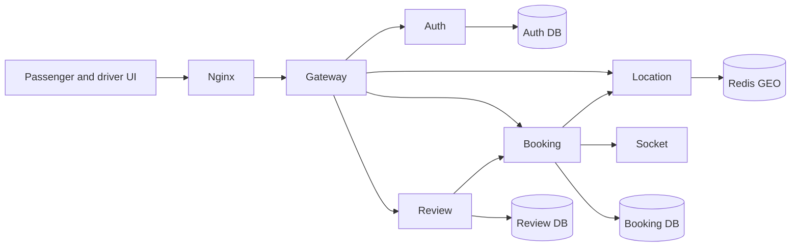
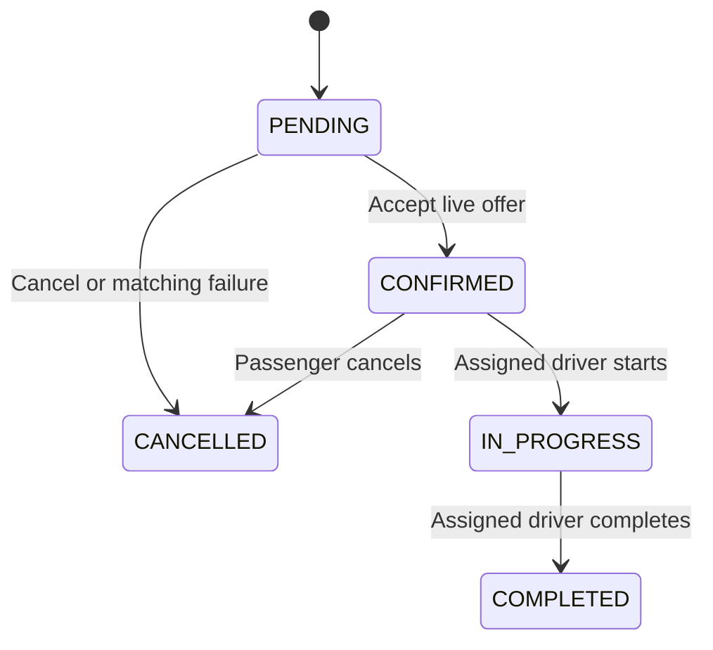

# Architecture

## Overview

Authentication, location, booking, socket notification and reviews are separate Spring Boot services. Eureka provides discovery and the gateway is the HTTP entry point. Passenger and driver portals use separate layouts and sessions.

## Request boundary

The gateway verifies JWTs, applies role/path rules, strips client X-User-* headers and inserts verified identity headers. Driver actions check offer/ride ownership. Passenger resource ownership and authenticated internal calls remain incomplete; unpublished ports reduce exposure but do not replace authorization.

## Dispatch

Booking-service persists PENDING and queries up to 20 nearest candidates within the configured radius (default 5 km). It skips previously tried drivers and drivers with live offers or CONFIRMED/IN_PROGRESS rides. The first eligible driver receives an OFFERED row with creation time, expiry and version. Defaults are 20 seconds per offer, five attempts and a two-second sweep.

Initial absence of an eligible driver cancels with NO_DRIVERS_NEARBY. Rejection/expiry attempt reassignment; exhaustion cancels with NO_DRIVER_AVAILABLE. Initial location failure cancels with BOOKING_FAILED. The sweeper also retries recent PENDING bookings without OFFERED rows, within a 15-minute creation window.

Offers transition from OFFERED to ACCEPTED, REJECTED, EXPIRED or WITHDRAWN. Cancellation withdraws open offers. Legacy accept requires a live offer; legacy internal completion still permits completion from CONFIRMED and needs further restriction.

## Consistency and delivery

Version fields detect conflicting writes to the same rows. Busy-driver checks do not atomically reserve a driver across concurrent bookings. Atomic reservation, database constraints and scheduler coordination are required before scale-out. Successful booking creation stores a globally unique idempotency key; keys are not passenger-scoped or payload-validated. Event publication has no transactional outbox or guaranteed atomic database/event delivery.

Socket notification is best effort behind a circuit breaker. React screens poll approximately every three seconds; drivers submit positions every five seconds. Redis TTL is the fallback for stale positions. Browser termination and in-flight heartbeat/offline races need stronger handling.

## Persistence and deployment

Auth, booking and review use separate databases. Cross-service passenger/driver references are plain ids. RideOffer is owned by booking-service. Reviews have a unique bookingId; idempotency records have a unique key. Address labels are browser lookups, not persisted data.

Existing native MySQL booking.status enums missing IN_PROGRESS require inspection and a controlled upgrade. Do not reset valuable volumes to change a schema. Flyway remains planned.

Compose implements seven Java services, frontend, MySQL and Redis with optional experimental Redpanda. Only loopback frontend, gateway and Eureka ports are published. Image builds skip tests; run Maven tests separately. Production TLS, least-privilege database users, backups and resource limits are not configured.

## Validation and next work

The sequential local driver-flow suite was reported passing with 71 checks and zero failures. Docker startup, browser coverage and real concurrency are separate checks. The new Postman demo has not been runtime-executed here. Kafka publishing remains experimental, with no new consumer provided by Compose.

Next work: passenger ownership, authenticated internal APIs, atomic driver reservation, scoped idempotency, outbox delivery, migrations, driver approval, browser automation and WebSocket UI updates.
