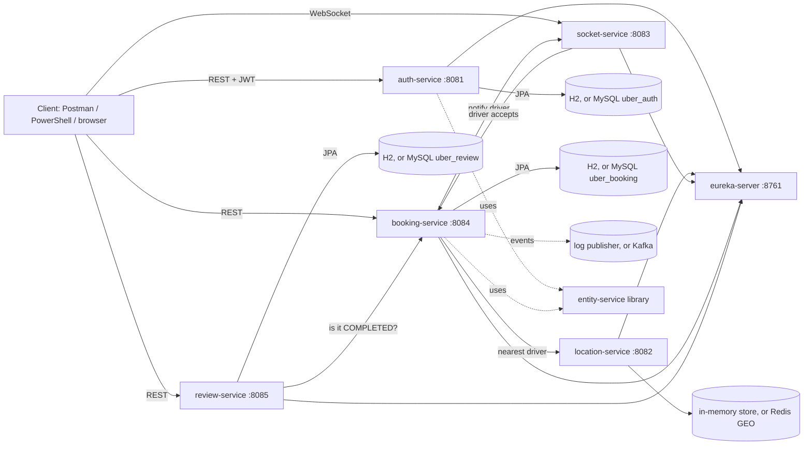
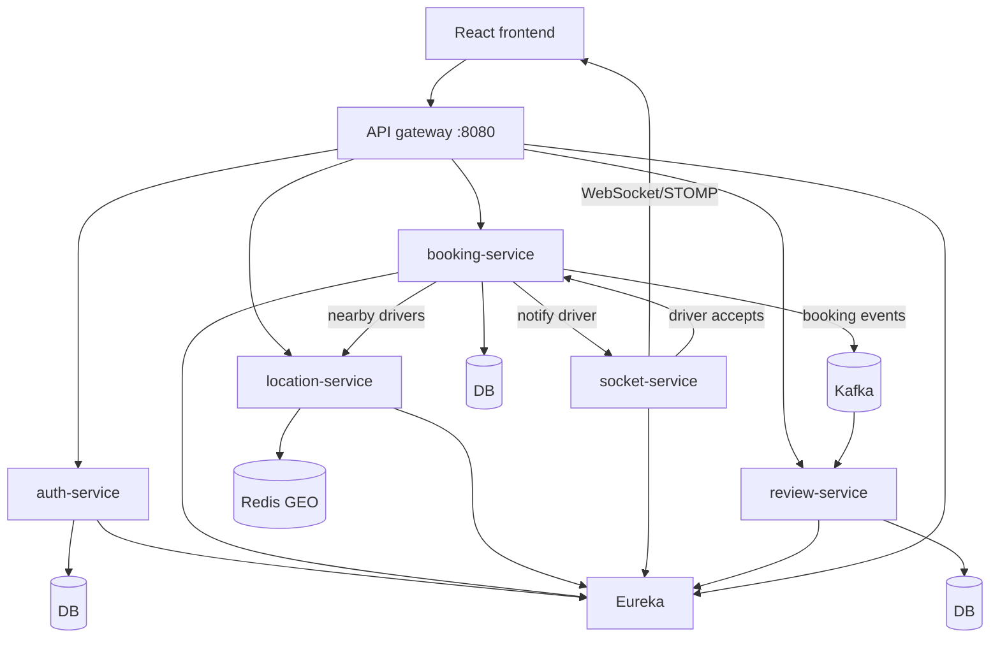
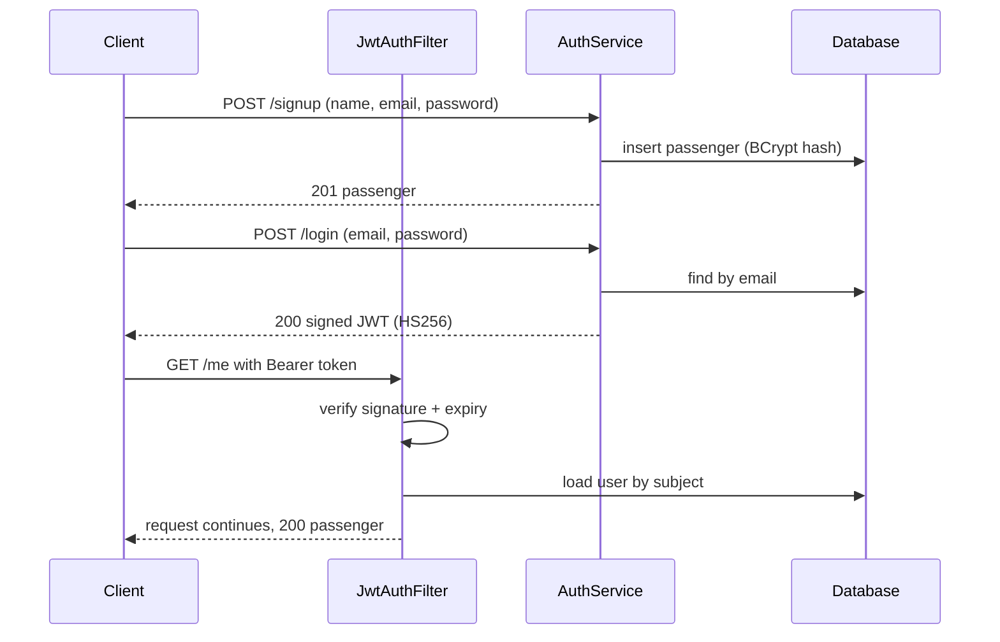
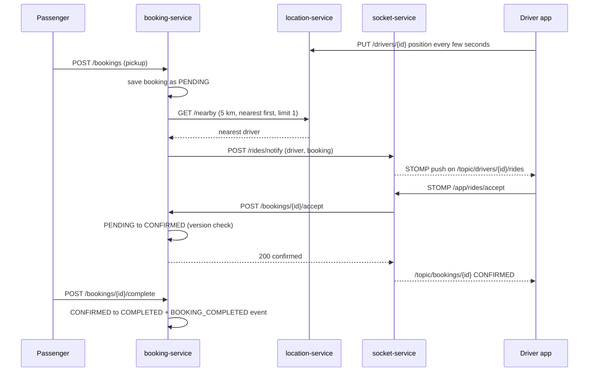
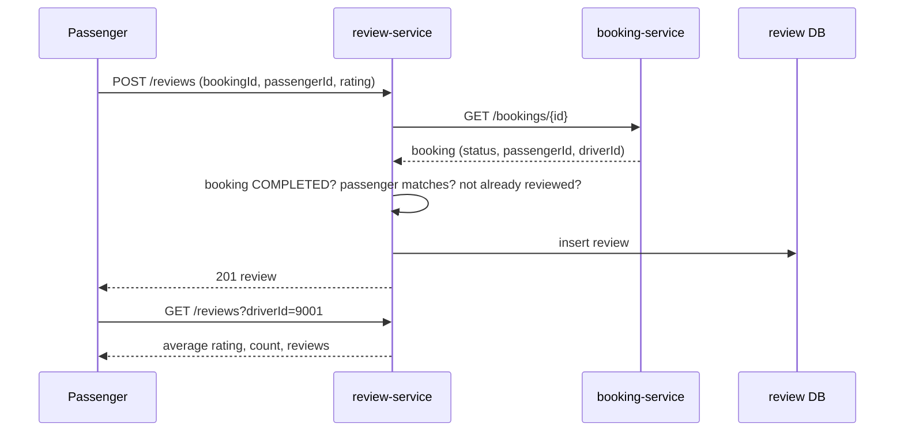
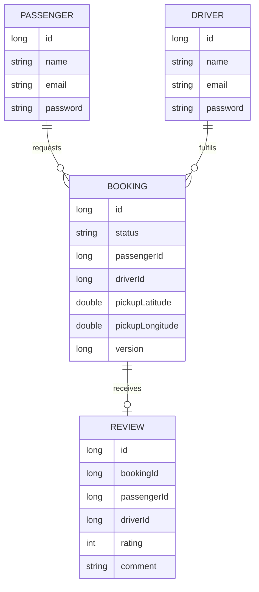

# High-Level Design

This document covers the whole target system, and says clearly which parts exist today.

## 1. Goal

Simulate the core flow of a ride-hailing app: a passenger requests a ride, nearby drivers are found, one driver is notified instantly, accepts, the ride is completed, and the passenger can review the driver. The point is to practise the distributed-systems problems behind that flow, not to clone a product.

## 2. What is built (Phase 1-6)

## 3. Target architecture (all phases)

Phase 7-8 add the gateway and the frontend. Each service has its own database or store.

## 4. Local mode and Docker mode

Every service has two ways to run, chosen by a Spring profile, so the same code is tested locally first and in Docker last:

| Concern | Local default | Real store (profile) | Used in |
|---------|---------------|----------------------|---------|
| Auth database | H2 in memory | MySQL, profile `mysql` | local with MySQL installed, Docker |
| Booking database | H2 in memory | MySQL, profile `mysql` | local with MySQL installed, Docker |
| Review database | H2 in memory | MySQL, profile `mysql` | local with MySQL installed, Docker |
| Driver locations | In-memory store | Redis GEO, profile `redis` | local with Redis installed, Docker |
| Booking events | Logged by an in-process publisher | Kafka, profile `kafka` | Docker stage |
| Review trigger | Review-service calls booking-service | Kafka consumer of `BOOKING_COMPLETED` | Docker stage |
| Service discovery | Eureka on localhost | Eureka container | Docker |

The in-memory and real implementations sit behind the same interface (`LocationStore`, `BookingEventPublisher`), which is also a useful design point to explain in an interview. Driver positions stay in a memory-class store (Redis) even in production, because they change every few seconds and expire; users, bookings and reviews are durable data and belong in MySQL.

## 5. Authentication flow (built)

Without a valid token the filter leaves the request unauthenticated and the security entry point answers 401.

## 6. Ride request flow (built)

If no driver is nearby the booking is saved as CANCELLED with reason `NO_DRIVERS_NEARBY` and the caller gets a 409. If socket-service is down, the booking stays PENDING and a warning is logged. If location-service is down, the caller gets a 503.

## 7. Review flow (built)

Rules: one review per booking, only the booking's passenger can write it, rating must be 1-5, and the booking must be COMPLETED. A duplicate review, a non-completed booking or a wrong passenger is refused.

## 8. Data model

Booking references passengers and drivers by plain id, not by a foreign key, because they live in other services' databases. Booking status values: PENDING, CONFIRMED, COMPLETED, CANCELLED. The `version` column is for optimistic locking, so two drivers cannot both accept the same ride. Review has a unique constraint on `bookingId`, so one booking can be reviewed once.

## 9. Decisions and trade-offs

| Decision | Why | Cost / what I'd change |
|----------|-----|------------------------|
| Stateless JWT instead of sessions | Any instance can verify a token, no shared session store | Tokens can't be revoked before expiry; a refresh-token flow would fix this |
| BCrypt for passwords | Slow by design, salted automatically | None for this scale |
| Shared `entity-service` library | One definition of the core entities | Compile-time coupling between services, and each consumer must scan its package (`@EntityScan`) and enable auditing itself. Review-service owns its own entity instead |
| Database per service | Services can evolve schemas independently | No cross-service joins; services call each other or react to events |
| Ids instead of foreign keys across services | A booking can't hold a real FK to a table in another database | Referential integrity is enforced in code |
| H2 and in-memory stores by default | Anyone can run the project with just a JDK | They behave differently from MySQL and Redis, so everything is re-tested against the real stores |
| Driver positions expire (TTL) | A driver whose app closed must not be offered rides | The in-memory store checks age on read; Redis uses a separate TTL key because GEO members can't expire individually |
| Plain WebSocket + STOMP with a simple in-memory broker | Easy to run and test | One socket-service instance only; scaling out needs an external broker (RabbitMQ or Redis pub/sub) |
| Socket service calls booking over REST | Simple and testable | A gRPC call would be a later, optional experiment |
| Optimistic locking for accept | Two drivers accepting at once cannot both win, with no explicit lock | The loser gets a 409 and must be told to look for another ride |
| Review checks the booking over REST | Simple, and the rule (COMPLETED + right passenger) stays in one place | A Kafka consumer would decouple the services and survive booking-service downtime; planned for the Docker stage |
| Unique constraint on review.bookingId | The database itself stops duplicate reviews, even under concurrent requests | A second insert attempt fails; the service checks first for a friendlier 409 |
| Booking events behind an interface | Same code logs locally and publishes to Kafka in Docker | At-least-once delivery with no outbox: an event can be lost if the process dies between the DB write and the publish |
| `ddl-auto=update` | Fast to develop against | Not for production; I'd switch to Flyway migrations |
| Spring Boot 3.5.16 | Supports Java 17 to 25 | Boot 3.5 no longer gets free security patches; moving to Boot 4.x is a later upgrade |
| Maven multi-module build | One parent POM pins versions for every service | A change to the library rebuilds its dependants |

## 10. Known gaps

- No refresh tokens or email verification, and only passengers can log in so far (driver login is not built).
- Location, socket, booking and review have no authentication yet; the gateway in Phase 7 is where JWT checking moves, and these services should then not be reachable directly.
- Booking only tries the single nearest driver. There is no timeout, no re-dispatch to the next driver if they ignore the ride, and the chosen driver (`candidateDriverId`) is returned on create but not stored, so `accept` does not check that the accepting driver is the one who was notified.
- Booking driver ids must be numeric, while location accepts any string id.
- Creating a booking is not idempotent: a retried request creates a second booking (an idempotency key is planned for Phase 7).
- Review-service checks the booking synchronously over REST. If booking-service is down, reviews cannot be created (503). The Kafka-based flow is planned for the Docker stage.
- No integration tests against real Redis, MySQL or Kafka (Testcontainers is planned for the Docker stage); the Kafka publisher and consumer have not been run yet.
- The WebSocket flow is tested by hand in the browser page, not by an automated test.
- The auth service creates tables for every entity in the shared library, not just `passenger`.
- Default JWT secret in `application.properties` is for local use only. Set `JWT_SECRET` anywhere else.
- On Windows PowerShell 5.1 the `health status is UP` line in some smoke tests reports a false failure (the Actuator content type comes back as bytes).

## 11. Roadmap

7. **Resilience and edge**: gateway routing and JWT check, circuit breaker on booking to socket calls, tracing, idempotency key on booking creation, driver re-dispatch on timeout.
8. **React frontend**: booking form, live driver map (Leaflet + OpenStreetMap, free).
9. **Docker**: Compose for every service with MySQL, Redis and Kafka, a Kafka consumer in review-service, and a full Docker test guide.
