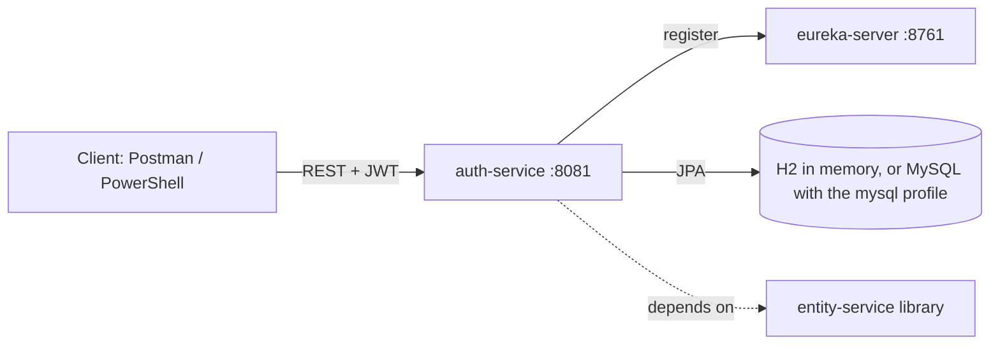
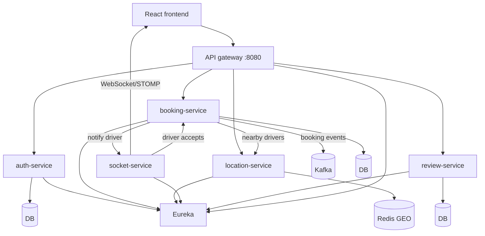
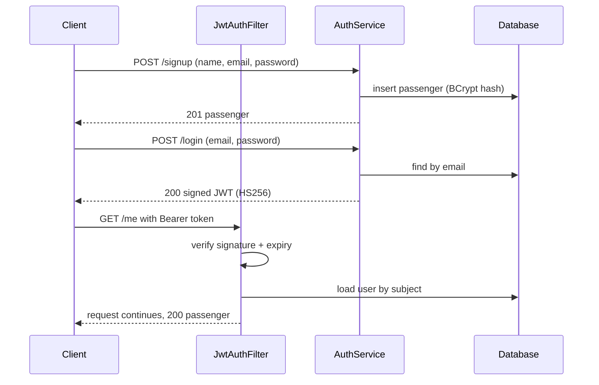
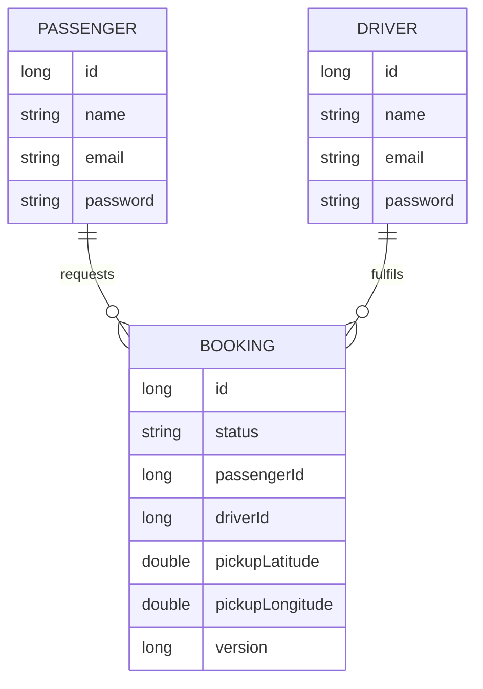

# High-Level Design

This document covers the whole target system, and says clearly which parts exist today.

## 1. Goal

Simulate the core flow of a ride-hailing app: a passenger requests a ride, nearby drivers are found, one driver is notified instantly, accepts, and the ride can later be reviewed. The point is to practise the distributed-systems problems behind that flow, not to clone a product.

## 2. Current architecture (Phase 1-2, built)

## 3. Target architecture (all phases)

Phases 3-8 add the boxes on the right. Each service has its own database or store.

## 4. Local mode and Docker mode

Every service has two ways to run, chosen by a Spring profile, so the same code is tested locally first and in Docker last:

| Concern | Local (default) | Docker (final step) |
|---------|-----------------|---------------------|
| Database | H2 in memory | MySQL, profile `mysql` |
| Driver locations (Phase 3) | In-memory store | Redis GEO, profile `redis` |
| Booking events (Phase 5) | Logged by an in-process publisher | Kafka, profile `kafka` |
| Service discovery | Eureka on localhost | Eureka container |

The in-memory and real implementations sit behind the same interface, which is also a useful design point to explain in an interview.

## 5. Authentication flow (built)

Without a valid token the filter leaves the request unauthenticated and the security entry point answers 401.

## 6. Data model

All entities extend `BaseModel` (id, createdAt, updatedAt). Auditing is switched on in the service that uses the library (`JpaConfig` in auth-service).

Booking references passengers and drivers by plain id, not by a foreign key, because they live in other services' databases. Booking status values: PENDING, CONFIRMED, COMPLETED, CANCELLED. The `version` column is for optimistic locking, so two drivers cannot both accept the same ride.

## 7. Decisions and trade-offs

| Decision | Why | Cost / what I'd change |
|----------|-----|------------------------|
| Stateless JWT instead of sessions | Any instance can verify a token, no shared session store | Tokens can't be revoked before expiry; a refresh-token flow would fix this |
| BCrypt for passwords | Slow by design, salted automatically | None for this scale |
| Shared `entity-service` library | One definition of the core entities | Compile-time coupling between services. In a stricter setup each service owns its tables and talks through API contracts. I kept it for learning and will call it out honestly |
| Database per service | Services can evolve schemas independently | No cross-service joins; services call each other or react to events |
| Ids instead of foreign keys across services | A booking can't hold a real FK to a table in another database | Referential integrity is enforced in code, not by the database |
| `ddl-auto=update` | Fast to develop against | Not for production; I'd switch to Flyway migrations |
| H2 by default, MySQL by profile | Anyone can run the project with just a JDK | H2 behaves slightly differently from MySQL, so the Docker stage re-tests everything |
| Spring Boot 3.5.16 | Supports Java 17 to 25, so it runs on a current JDK | Boot 3.5 no longer gets free security patches; moving to Boot 4.x is a later, separate upgrade |
| Maven multi-module build | One parent POM pins Spring Boot and Spring Cloud versions for every service; the shared library is resolved inside the same reactor | A change to the library rebuilds its dependants |
| Eureka for discovery | Easy to demo and widely used with Spring Cloud | Kubernetes-native discovery would replace it in a real deployment |

## 8. Known gaps

- No refresh tokens, no OTP/email verification, and only passengers can log in so far (driver login is not built).
- No integration tests with a real database (Testcontainers is planned for the Docker stage).
- The auth service creates tables for every entity in the shared library, not just `passenger`. Harmless, but a sign the library boundary is loose.
- Default JWT secret in `application.properties` is for local use only. Set `JWT_SECRET` anywhere else.

## 9. Roadmap

3. **Location service**: add and search driver positions, nearby drivers within a radius.
4. **Socket service**: STOMP endpoint, push ride requests to a driver topic.
5. **Booking service**: create booking, call location and socket, confirm on driver accept, publish events.
6. **Review service**: ratings tied to a booking.
7. **Resilience and edge**: gateway routing, circuit breaker on booking to socket calls, tracing, idempotency key on booking creation.
8. **React frontend**: booking form, live driver map (Leaflet + OpenStreetMap, free).
9. **Docker**: Compose with MySQL, Redis and Kafka, and a full Docker test guide.
