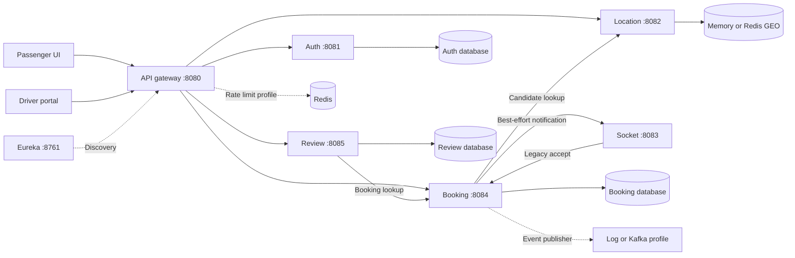
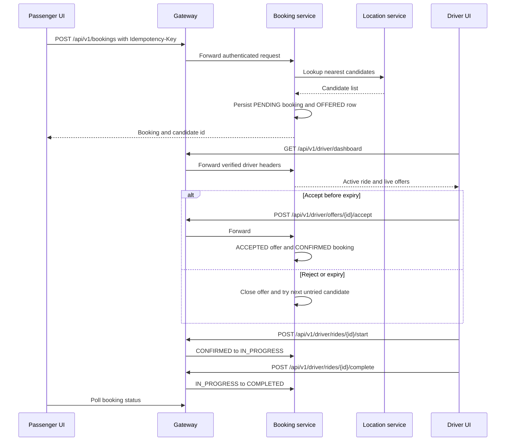
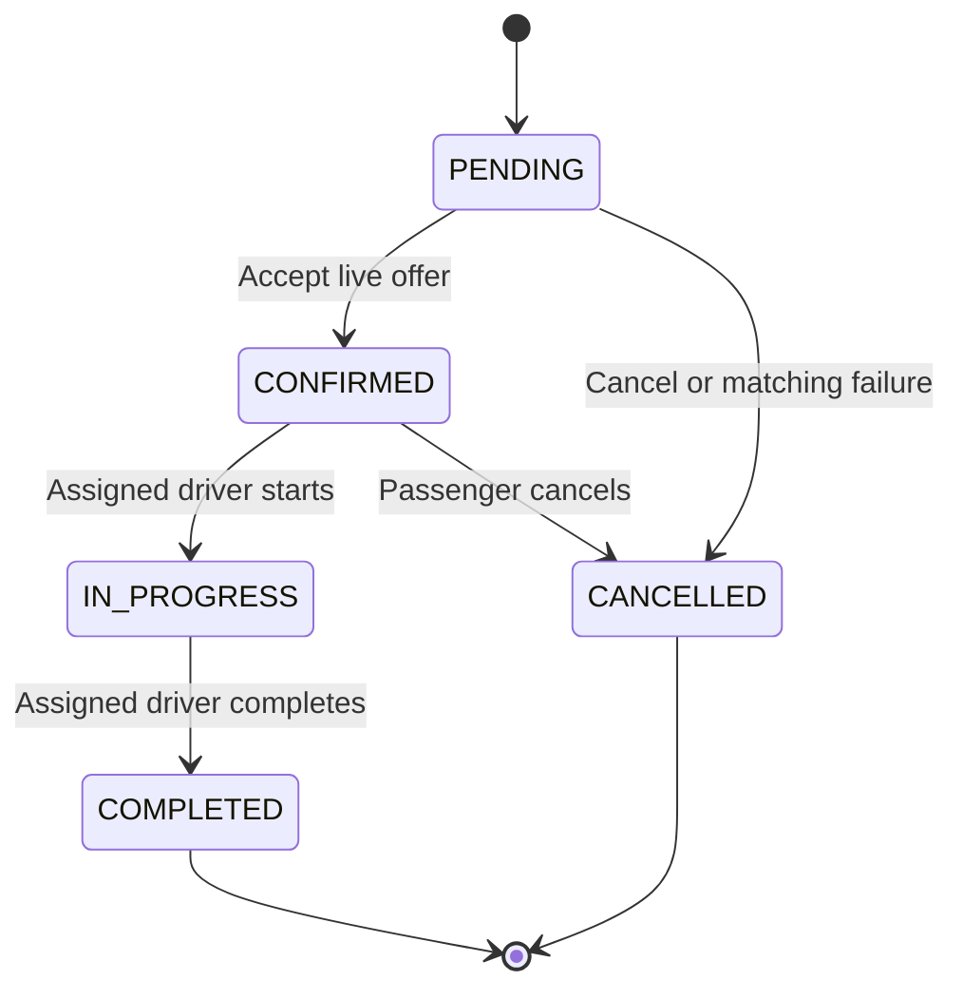
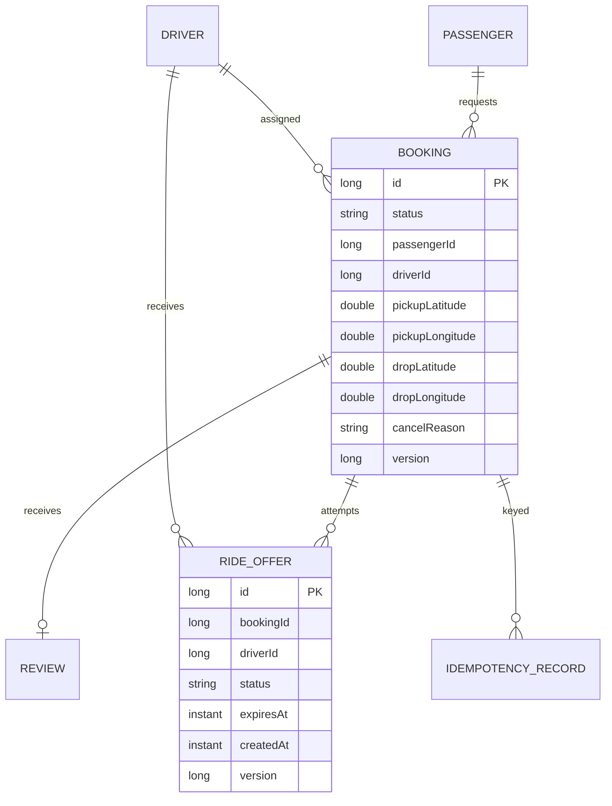

# High-Level Design

## 1. Scope and verification status

The platform models passenger booking, driver matching, trip execution and reviews. Phases 1-8 provide the service foundation and passenger UI. Phase 9 adds driver authentication, a separate portal, location heartbeats, persisted offers, expiry, reassignment and driver trip actions. Both UIs still poll; WebSocket subscriptions in the React apps are not implemented.

The user confirmed the backend build succeeds. Local smoke-test output demonstrated acceptance, reassignment, trip start/completion, cancellation, expiry and role checks. Four single-offer assertions failed in the expiry-inclusive run; the PowerShell array-return fix was pushed as f53014e. A zero-failure rerun has not yet been explicitly reported. Frontend browser verification and concurrency/infrastructure integration tests remain separate from a successful Maven build.

## 2. Implemented architecture



Backend services register with Eureka. Gateway routes use load-balanced service names. React 18, Vite and Leaflet run on port 5173; the development proxy forwards /api to port 8080 without stripping the prefix. Java targets version 17. The shared entity-service is a library, not a running service.

| Concern | Default | Optional profile |
|---|---|---|
| Auth, booking and review persistence | H2 | mysql, separate uber_auth / uber_booking / uber_review databases |
| Driver positions | In-memory store | redis |
| Gateway rate limiting | Disabled | redis |
| Booking events | Log publisher | kafka |
| Review validation | Synchronous REST booking lookup | Kafka-based decoupling remains a target |

Docker Compose does not yet represent a complete deployment of every service.

## 3. Authentication and gateway boundary

Passenger auth uses /api/v1/auth/signup, /login and /me. Driver signup and login use /api/v1/auth/signup/driver and /login/driver; driver profile uses /api/v1/auth/driver/me. Driver JWTs include role=DRIVER and numeric userId. Passenger and driver browser storage keys are separate; main.jsx selects separate layouts.

The gateway strips client-supplied X-User-* headers before forwarding. For authenticated requests it derives X-User-Email and X-User-Role from verified claims, and X-User-Id when a numeric userId claim exists. Older passenger tokens can lack an id claim.

| Caller | Access policy |
|---|---|
| Unauthenticated | Exact public auth paths, health and fallback paths; protected routes return 401 |
| Driver | Driver API paths, driver profile path, and PUT/DELETE on its own numeric location id; other protected paths return 403 |
| Passenger | Existing passenger routes; driver API/profile paths, numeric driver location writes and legacy booking accept/complete paths are blocked |

Routes /api/v1/bookings/** and /api/v1/driver/** reach booking-service in both gateway YAML configurations. Auth, locations and reviews retain separate routes. Driver and booking routes share bookingCB and the booking fallback. With the Redis profile the driver route allows 5 requests per second with burst 20, keyed by the existing rate-limit policy.

Important: these are implemented path rules, not full resource authorization. Driver controllers validate role and offer/ride ownership using trusted headers. Passenger booking endpoints still trust supplied passenger ids and lack ownership checks. Location accepts string ids, whereas the gateway location-write matcher recognizes numeric ids; passenger authorization for non-numeric location paths needs hardening. Direct service-port access bypasses the gateway and can forge identity headers. This is a local-development trust boundary, not production-grade service authentication.

## 4. Availability and matching

The driver selects a location by map click or geolocation. Going online sends PUT /api/v1/locations/drivers/{id}, then repeats every 5 seconds. Going offline sends DELETE. Location TTL removes stale positions. Logout/unmount removal is best effort; page termination and network loss cannot guarantee immediate deletion.

Booking creation saves PENDING, then asks location-service for up to 20 nearest candidates within the configured radius (default 5 km). Matching skips non-numeric ids, drivers already tried for this booking, drivers with live offers and drivers with CONFIRMED or IN_PROGRESS rides. The first eligible candidate receives an OFFERED row.

| Setting | Default |
|---|---|
| BOOKING_OFFER_TTL_SECONDS | 20 seconds |
| BOOKING_OFFER_MAX_ATTEMPTS | 5 offers per booking |
| BOOKING_OFFER_SWEEP_MS | 2000 milliseconds |

No eligible initial candidate produces CANCELLED / NO_DRIVERS_NEARBY and HTTP 409. Initial location lookup failure produces CANCELLED / BOOKING_FAILED and HTTP 503. Creation uses noRollbackFor=ResponseStatusException so these cancellations persist. Idempotency records are saved only after a successful offer; unsuccessful creation does not reserve its key. Existing keys return the associated booking. Keys are neither passenger-scoped nor payload-validated and need further hardening.

## 5. Offer and trip flow



Driver dashboard and passenger ride status refresh approximately every 3 seconds plus request time. Offer responses include expiresAt and secondsRemaining; the browser displays a local countdown, but server time controls acceptance. Driver history is GET /api/v1/driver/rides.



An OFFERED row transitions to ACCEPTED, REJECTED, EXPIRED or WITHDRAWN. Passenger cancellation is allowed only for PENDING/CONFIRMED and withdraws open offers. The passenger UI no longer exposes completion. The legacy internal complete endpoint still accepts CONFIRMED or IN_PROGRESS, so the strict start-before-complete rule applies to the driver API, not every direct internal call. Legacy accept requires a matching live offer, but direct internal endpoint authentication remains a gap.

## 6. Expiry, recovery and consistency limits

OfferExpiryJob runs with fixed delay. Each expired-offer action executes through a transactional DriverRideService method, closes the offer and attempts reassignment. Rejection also attempts reassignment. No remaining eligible candidate or attempt-cap exhaustion produces CANCELLED / NO_DRIVER_AVAILABLE.

If location lookup fails during reassignment, the closed offer can persist while the booking stays PENDING. A subsequent sweep looks for PENDING bookings without OFFERED rows, but only within a 15-minute creation window. Older stranded bookings require operational recovery.

Offers and bookings have @Version fields. Concurrent writes to the same persisted row can conflict rather than silently overwrite one another. This is not an atomic driver-reservation mechanism: two distinct booking transactions can both observe the same driver as free and create separate offers. Concurrent sweeps/reassignments also lack a unique live-offer constraint or distributed lock. The intended single-offer/single-active-ride rules are best-effort checks, not proven cross-booking invariants. Before multi-instance or production use, add atomic driver reservation, serialized dispatch, database constraints and concurrency integration tests.

Socket notification is best effort behind a circuit breaker; dashboard polling does not depend on delivery. Events publish through BookingEventPublisher without a transactional outbox. Atomic database/event delivery and at-least-once delivery are not guaranteed by the current implementation.

## 7. Persistence model and schema upgrade



Diagram relationships are logical; passenger and driver references cross service databases and are plain ids. Review has a unique bookingId; IdempotencyRecord has a unique idempotencyKey. RideOffer lives in booking-service and is included in its entity scan.

Before upgrading an existing local MySQL booking database, inspect the schema and back up important data. If status is a native enum missing IN_PROGRESS, widen it while booking-service is stopped:

```sql
USE uber_booking;
SHOW CREATE TABLE booking;
ALTER TABLE booking MODIFY COLUMN status
ENUM('PENDING','CONFIRMED','IN_PROGRESS','COMPLETED','CANCELLED') NOT NULL;
```

Do not blindly replace a different column definition. H2/fresh databases do not require this manual enum upgrade. The application uses ddl-auto=update; controlled Flyway migrations remain planned.

## 8. Review flow

Review-service reads booking-service over REST, checks COMPLETED status, compares the supplied passenger id with the booking and rejects duplicate reviews. Ratings are 1-5. Comparing supplied ids is not equivalent to authenticating booking ownership; caller-bound passenger authorization remains required.

## 9. Validation and local tests

Stop running JARs before clean builds on Windows. Run .\scripts\mvn.ps1 clean install with tests enabled, and npm run build inside frontend. Start Eureka and backend services; use real MySQL/Redis profiles when validating those stores.

BookingServiceTest, OfferServiceTest, DriverRideControllerTest and JwtAuthFilterTest cover selected service/controller/filter behavior with mocks. They do not establish database concurrency guarantees.

With the gateway running without its Redis rate-limit profile:

```powershell
.\scripts\smoke-test-driver-flow.ps1
.\scripts\smoke-test-driver-flow.ps1 -IncludeExpiry
```

The script creates persistent local test accounts/bookings, uses Delhi coordinates, and normally removes its test driver locations at the end. A crashed run may skip cleanup. Other online drivers near those coordinates can interfere. Expected successful totals are 37 checks without expiry or 41 with expiry, both with zero failed. Use disposable local data; these scripts are not for production.

Manual UI verification: go online as a driver, book nearby as a passenger, accept, start, complete, inspect both histories, reject a subsequent request, let another expire, and verify DELETE on offline. Repeat with two driver accounts in isolated browser sessions to observe reassignment. Polling and heartbeat requests should be inspected separately from build success.

## 10. Trade-offs and remaining roadmap

- JWT verification at the edge simplifies local services but needs service-level authentication, network isolation, refresh/revocation and caller-bound ownership checks.
- One-driver-at-a-time dispatch is easy to follow but incurs timeout latency; atomic reservation and distributed scheduling must precede scale-out.
- Separate databases avoid cross-service joins but introduce synchronous REST dependencies and shared-entity compile-time coupling.
- Redis GEO plus TTL supports proximity lookup, not guaranteed ride availability; booking checks activity separately.
- React polling avoids socket-session complexity but adds latency and background traffic. Browser closure, logout paths and in-flight heartbeat/offline races need stronger lifecycle handling.
- Driver approval, persisted place names, pagination, offer-query indexes, stale-booking recovery, scoped idempotency and automated browser tests remain work.
- Legacy smoke scripts may assume passenger-authorized location writes or unrestricted legacy accepts; those assumptions are obsolete.
- Next hardening work: passenger ownership, atomic dispatch reservations, Flyway, WebSocket UI delivery and outbox-based events.
- Final deployment work: complete Docker Compose, Redis/MySQL/Kafka integration verification, Testcontainers and an operational runbook.
